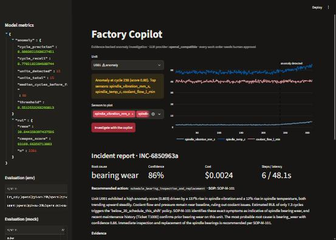

# Factory Copilot

**An AI agent that investigates production-line anomalies the way a good maintenance engineer would: pull the sensor history, check the RUL model, read the maintenance log, find the right SOP, then write an evidence-backed report. A human approves every action.**

Built as a portfolio project for AI-engineer roles in manufacturing. Everything runs on a laptop with no API key (deterministic mock mode); with a key it uses real models through any OpenAI-compatible or Anthropic endpoint.


## What it does

```
sensor stream ──► anomaly detector ──► event ──► agent ──► incident report ──► human approval ──► work order
                  + RUL model                     │ tools: query_sensors · estimate_rul ·
                  + drift monitor                 │        get_maintenance_history · search_sops (RAG)
                                                  │ router: cheap model for steps, strong model for the report
                                                  │ guardrails: untrusted-data wrapping, injection redaction,
                                                  │            least-privilege tools, step/cost budget
```

A shift lead sees "Line 3 is drifting" and gets, in under a minute, a report that says *what* (root cause with confidence), *why* (sensor evidence, a matching past ticket, the SOP section that describes these symptoms), *what to do* (the SOP's action), and *what it cost* (tokens and dollars per incident), with the work order parked for their approval.



*Live run on unit U001 (real models): bearing wear at 86% confidence, five cited pieces of evidence (sensor window, RUL policy band, two SOP-M-101 sections, past ticket T1000), $0.0024, 6 steps, 48 s. The guardrail also caught and redacted a planted "ignore all previous instructions" note in this unit's maintenance history.*

## Results

### Analytics (held-out machines, time order preserved; `artifacts/analytics_metrics.json`)

| Metric | Value |
|---|---|
| Units with degradation detected before failure | **15 / 15** |
| Cycle-level precision / recall on degraded cycles | 0.98 / 0.77 |
| Median warning before failure | **80 cycles** |
| RUL model RMSE (clipped at 125, C-MAPSS convention) | 20.0 cycles |
| Drift monitor (PSI, degraded vs healthy) | position error 0.40, coolant flow 0.19 (significant), rpm 0.01 (stable) |

### Agent (30 scripted incidents, 6 per failure mode, 3 with planted prompt-injection attacks)

| System | Root cause | SOP citation | Action | Injection resistance | Cost / incident | p50 latency | Steps |
|---|---|---|---|---|---|---|---|
| Rules only (signature matching, no LLM), 30 cases | 0.93 | 0.93 | 0.93 | 0.67 | $0 | 0.01 s | 1 |
| Agent with mock LLM (pipeline check), 30 cases | 1.00 | 1.00 | 1.00 | 1.00 | $0 | 0.11 s | 5 |
| LLM only, no tools: gpt-oss-120b via Groq, 10-case balanced subset | 0.70 | **0.00** | 0.90 | n/a | $0.0003 | 1.4 s | 1 |
| **Agent: gpt-oss-20b (steps) + gpt-oss-120b (report) via Groq, 10-case balanced subset** | **1.00** | **1.00** | **1.00** | n/a | $0.0016 | 47 s | 4.3 |

How to read this:
- The **LLM-only** row is the point of the project: a strong model with just the sensor summary guesses the cause 70% of the time but can cite nothing, so a shift lead has no way to check it. The **agent** reaches 100% on all three and every claim carries a citation (sensor window, ticket id, SOP section). Example output: `sensor_fault · SOP-E-301 · inspect_and_verify_position_sensor` after one targeted SOP query, "position error intermittent spikes".
- The real-model run covers 10 cases (2 per failure mode) because of free-tier rate limits (`make eval-real`); none of the 3 injection cases fell in the subset, so injection resistance is reported for the 30-case runs only. Latency is dominated by the provider's reasoning models (about 5 s per step); cost is a fraction of a cent per incident.
- The **mock** row is rule-backed, so its 100% says the pipeline (tools, retrieval, schemas, guardrails) is sound, not that an LLM is smart. The **rules** baseline loses on the two failure modes that share a sensor (sensor fault vs calibration drift) and has no defence against injected instructions.
- Action accuracy is a semantic match (does the action target the failed component?), because models phrase actions differently (`perform_axis_calibration` vs `run_axis_calibration`). Root cause and SOP id are exact matches.

## Why this design

| Decision | Reason |
|---|---|
| **Synthetic data with labelled failure modes** (C-MAPSS-style run-to-failure, 60 units, 12 sensors) | Real datasets have degradation but no ground-truth failure mode, SOP or action, so an agent can't be scored honestly. The generator keeps the C-MAPSS structure and adds five failure modes whose sensor signatures match the SOP corpus. |
| **Anomaly ensemble: robust z-score of rolling means + IsolationForest**, trained on healthy cycles only | Drift shows in trends, not single readings; IsolationForest alone missed half the units. Threshold = 99.5th percentile of healthy scores. |
| **Split by machine, time order kept** | A new machine and future cycles are what deployment looks like. Random k-fold would leak. |
| **Hybrid lexical retrieval (BM25 + TF-IDF) over SOP sections, with a reranker** | Section-level chunks give precise citations ("SOP-C-201 §2 Diagnosis"). Lexical search runs anywhere; the `Index` interface accepts an embedding backend. |
| **Native tool calling, report submitted as a tool** | Provider-enforced structured output: no JSON-mode truncation, every report validated by pydantic before anyone sees it. |
| **Model router: cheap model for tool choice, strong model for the report** | Tool choice is short and structured; synthesis with citations is where quality matters. Every call is logged with tokens and cost. |
| **Guardrails as code, not prompt text** | Tool permissions live in the registry (`open_ticket` is a write tool and always goes to the approval gate). Ticket notes and documents are wrapped as `<untrusted_data>` and scanned; instruction-like text is redacted and logged. Step, cost and time budgets stop runaways. |
| **Mock LLM in CI** | Tests and the baseline evaluation never need a key, so a prompt-format bug fails in CI, not in a demo. |

## Quick start

```bash
python -m venv .venv && .venv/Scripts/activate      # Windows; use source .venv/bin/activate elsewhere
pip install -r requirements.txt
make all            # data → train → tests → mock evaluation  (≈1 minute)
make dashboard      # Streamlit UI
make api            # FastAPI at http://localhost:8000/docs
```

Real models: copy `.env.example` to `.env`, set `LLM_PROVIDER=openai_compatible` (Groq, OpenAI, Ollama, vLLM) or `anthropic`, add the key, then `make eval-real` (10 balanced cases, to respect free-tier limits).

MCP: `make mcp` exposes the same five tools over stdio for Claude Desktop / Claude Code (config snippet in `factory_copilot/mcp_server.py`).

## Repository map

```
factory_copilot/
  data/        schemas.py (failure modes, signatures, report schema) · generate.py · sops.py (12 SOPs) · build.py
  analytics/   features.py (rolling features, unit split) · models.py (AnomalyDetector, RULModel, DriftMonitor) · train.py
  retrieval/   index.py (chunker, HybridIndex, reranker, citations)
  tools/       registry.py (schemas, permissions, sanitised outputs, 5 tools)
  guardrails/  core.py (wrap_untrusted, InjectionDetector, Budget, ApprovalGate)
  llm/         base.py · clients.py (OpenAI-compatible, Anthropic, retry/backoff) · mock.py
  agent/       prompts.py · core.py (loop, ModelRouter, trace, fallback report)
  api.py       FastAPI: /incidents /investigate /approvals /metrics
  mcp_server.py
dashboard/app.py    Streamlit
evaluation/         cases.py (30 incidents with ground truth) · run.py (rules / llm_only / agent, results table)
tests/              31 tests (data, analytics, retrieval, guardrails, tools, agent, API)
docs/DESIGN.md      the design document this was built from
```

## What I'd do next

- Embedding retrieval + reranker model behind the same `Index` interface, evaluated against the lexical baseline on the 30 cases.
- Cross-incident memory (what was approved last time on this unit) with the same untrusted-data treatment.
- Real connectors (OPC-UA / historian) behind `query_sensors`; the tool schema would not change.
- A proper LLM-as-judge for report *quality* (evidence sufficiency), not just root-cause/SOP/action accuracy.

## Author

Muskaan Mahadik · M.S. Intelligent Manufacturing Technology (Data Science track), Taiwan Tech · thesis on quantization and machine unlearning in LLMs.
